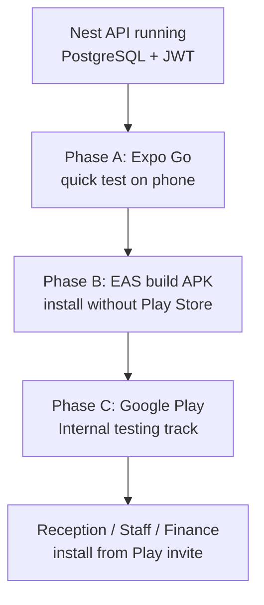

# Aspire Coworks Mobile — runbook (for beginners)

You already have the code. This guide is the **path from laptop → phone → Google Play internal testing**.

## Big picture




Do **Phase A** first. Only do Google Play (Phase C) when the app works on a real phone.

---


## Phase A — Test on your phone (no Google account needed)


### A1. Run the API

On your PC:

```bash
cd aspirecoworks_client_onboard
npm run start:dev
```

API should be at npm run start:devnpm run start:dev.

### A2. Point the mobile app at the API

Edit `mobile/.env`:

```env
EXPO_PUBLIC_API_URL=http://YOUR_PC_LAN_IP:3000
```

Find your LAN IP (PowerShell):

```powershell
ipconfig
```

Use the IPv4 address of Wi‑Fi / Ethernet, e.g. `192.168.1.42` →  
`EXPO_PUBLIC_API_URL=http://192.168.1.42:3000`

Phone and PC must be on the **same Wi‑Fi**. `localhost` on the phone means the phone itself, not your PC.

Windows Firewall: allow inbound TCP **3000** if the phone cannot reach the API.

### A3. Start Expo

```bash
cd mobile
npm install
npx expo start
```

On your Android phone:

1. Install **Expo Go** from Play Store
2. Scan the QR code from the terminal


### A4. Login with demo users


| Role      | Email                                                             | Password      | What they see                  |
| --------- | ----------------------------------------------------------------- | ------------- | ------------------------------ |
| Reception | [reception@aspirecoworks.com](mailto:reception@aspirecoworks.com) | Reception123! | Find client + email mail photo |
| Staff     | [staff@aspirecoworks.com](mailto:staff@aspirecoworks.com)         | Staff123!     | Find + New client              |
| Finance   | [finance@aspirecoworks.com](mailto:finance@aspirecoworks.com)     | Finance123!   | Find + New + Payments/Invoices |


If login fails: API not reachable from phone, wrong `.env`, or backend not running.

---


## Phase B — Build a real Android APK (still no Play Store)

Use this to share an installable file with a few staff phones without Play review.

### B1. Accounts

1. Create a free account at [expo.dev](https://expo.dev)
2. On your PC:

```bash
npm i -g eas-cli
cd mobile
eas login
eas init
```

`eas init` links the folder to an Expo project (creates a project ID in `app.json`).

### B2. Build APK

Already configured in `eas.json` as profile `preview` (APK).

```bash
cd mobile
eas build --profile preview --platform android
```

First time, EAS may ask to generate an Android keystore → choose **yes** (Expo can manage it for you).

When the build finishes, Expo gives a **download URL**. Open it on a phone and install the APK  
(enable “Install unknown apps” for the browser if Android asks).

### B3. Production API URL

For a shared APK, `.env` at build time must point to your **public HTTPS API** (Render/Railway/etc.), not a LAN IP:

```env
EXPO_PUBLIC_API_URL=https://your-api.example.com
```

Then rebuild. The API URL is baked into the JS bundle at build time.

---


## Phase C — Google side setup (Play Console)

This is what people mean by “Google setup” for an Android business app.

### C1. Google Play Developer account

1. Go to [Google Play Console](https://play.google.com/console)
2. Sign in with a **Google Workspace / company Google account** (preferred)
3. Pay the **one-time registration fee** (~USD 25)
4. Complete identity / organization verification (can take days)
5. Accept developer agreements

Until verification finishes, you can often still create an app and use **Internal testing**.

### C2. Create the app in Play Console

1. **Create app** → name: `Aspire Coworks`
2. Language: English (India) or English
3. Type: **App**
4. Free
5. Declarations: usually **not** a news app / not government; complete as accurate for Aspire


### C3. Package name (already set in code)

Your Android application ID is:

`com.aspirecoworks.clientops`

**Never change this** after the first Play upload — Google treats it as the app identity forever.

### C4. Build an AAB for Play (not APK)

Play Store wants an **Android App Bundle (.aab)**, not APK.

Update / add an EAS production profile if needed, then:

```bash
cd mobile
eas build --profile production --platform android
```

Default EAS production builds produce an **.aab**. Download it when ready.

### C5. App signing (Google’s side)

On first upload, Play Console offers **Play App Signing**:

- Accept **Google manages the app signing key** (recommended)  
- Upload key = what EAS uses; Google re-signs for users

If EAS manages credentials, keep the Expo credentials backup; don’t lose them.

### C6. Store listing (required before production; lighter for internal)

Fill at least:

- Short + full description  
- App icon 512×512  
- Feature graphic 1024×500  
- Screenshots (phone) — take from Expo/APK  
- Category: Business  
- Contact email

Privacy policy URL is required for production; for internal testing you may still be asked — host a simple page on your site.

### C7. Internal testing track (best first distribute)

1. Play Console → your app → **Testing → Internal testing**
2. **Create email list** of staff Gmail accounts
3. **Create new release** → upload the `.aab` from EAS
4. Release name e.g. `1.0.0 (1)`
5. Review and roll out to Internal testing

Testers open the **opt-in link** from Play Console, accept, then install from Play Store.

Internal testing is usually available within minutes/hours — no full public review.

### C8. Closed / open testing → Production (later)

When ready for more people:

1. Closed testing → more testers
2. Production → full review (can take days)

For Aspire staff-only, **Internal testing** is often enough forever.

---


## Phase D — Security & ops checklist (important)


| Item                                                                 | Why                                                           |
| -------------------------------------------------------------------- | ------------------------------------------------------------- |
| HTTPS API in production builds                                       | Phones must not use plain HTTP to a public server             |
| Change demo passwords                                                | `Reception123!` etc. are for local only                       |
| Create real users in DB with roles `RECEPTION` / `STAFF` / `FINANCE` | Don’t share admin accounts                                    |
| CORS already allows API use                                          | Mobile uses Bearer token; ensure API is reachable on internet |
| Neon DB / API uptime                                                 | Mobile fails if API is down                                   |


Create a real user (example via seed script pattern or admin UI once you add user admin):

- Email: `reception.indiranagar@aspirecoworks.com`  
- Role: `RECEPTION`  
- Strong password

---


## What you do **not** need yet

- **Google Sign-In / OAuth** — app uses email/password against your Nest `/auth/login`  
- **Firebase** — not required for this architecture  
- **Apple Developer account** — only when you ship iOS  
- **Android Studio** daily — EAS builds in the cloud

---


## Suggested order for you this week

1. Phase A on your phone with LAN IP
2. Create real Reception/Staff/Finance users in **Admin → Mobile users**
3. Deploy Nest API to HTTPS host if not already
4. Follow **[EAS_INIT.md](./EAS_INIT.md)** (`eas login` → `eas init` → APK build)
5. Play Console + internal testing

